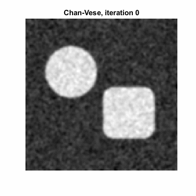

# Segmentation par contours actifs et level sets

Deux familles de modèles déformables codées à la main en MATLAB : le **snake paramétrique** de Kass, Witkin et Terzopoulos, et la **level set de Chan-Vese** (« active contours without edges »). Elles sont comparées entre elles et à un seuillage d'Otsu sur des images synthétiques avec vérité terrain. Une étude paramétrique complète mesure l'influence de chaque paramètre sur la qualité (Dice) et sur le temps de calcul.



## 1. Modèles

**Snake (contour paramétrique).** Le contour $`v(s)`$ minimise

```math
E = \int \alpha\|v'\|^2 + \beta\|v''\|^2 \,ds \;-\; \kappa \int \|\nabla(G_\sigma * I)\|^2 \,ds
```

- **Schéma semi-implicite** : $`(A + \gamma I)\,v_{t+1} = \gamma v_t + F_{ext}(v_t)`$, où $`A`$ est la matrice pentadiagonale circulante de l'énergie interne. Le déplacement par itération vaut environ $`F/\gamma`$ : $`\gamma`$ joue le rôle d'une **viscosité**, et le pas vaut $`1/\gamma`$.
- **Force ballon** (Cohen, 1991) : elle fait rétrécir le contour depuis une initialisation lointaine.
- **Rééchantillonnage** : les points sont redistribués régulièrement le long du contour tous les 10 pas.

**Chan-Vese (level set).** Le contour est le niveau zéro d'une fonction $`\varphi`$, ce qui permet les changements de topologie. On minimise

```math
E = \mu\,\mathrm{Longueur}(C) + \sum_{\text{intérieur}} (I - c_1)^2 + \sum_{\text{extérieur}} (I - c_2)^2
```

où $`c_1`$ et $`c_2`$ sont les moyennes des deux régions. Le modèle ne dépend pas du gradient de l'image. Choix d'implémentation :
- Heaviside et Dirac régularisés : $`H_\varepsilon = \tfrac12 + \tfrac1\pi\arctan(\varphi/\varepsilon)`$ et $`\delta_\varepsilon = \frac{\varepsilon/\pi}{\varepsilon^2+\varphi^2}`$. La courbure est calculée par différences centrées.
- Terme de données normalisé, $`(2I - c_1 - c_2)/(c_1 - c_2)`$, puis écrêté à $`[-1, 1]`$ : il ne dépend plus du contraste.
- **Réinitialisation** de $`\varphi`$ en distance signée tous les $`k`$ pas, par l'EDP de Sussman avec un schéma upwind de Godunov.
- **Arrêt automatique** : quand moins d'une fraction `tol` de pixels change entre deux réinitialisations, 3 fois de suite.

## 2. Expériences

Image 200 × 200 : objets à 0,75 sur un fond à 0,25 (contraste 0,5), bruit gaussien.

| Figure | Contenu |
|---|---|
| `fig1_comparaison.png` | Snake, Chan-Vese et Otsu sur deux objets bruités (σ = 0,15) |
| `fig2_topologie.png` + GIF | Évolution du contour de Chan-Vese : une seule région qui se **scinde** en deux |
| `fig3_energie.png` | Énergie et moyennes $`c_1`$, $`c_2`$ au fil des itérations |
| `fig4_dice_vs_bruit.png` | Dice moyen sur 10 tirages, bruit de 0,05 à 0,5 |
| `fig5_limites.png` | Cas d'échec : biais d'éclairage, initialisation mal placée |
| `fig6_medical.png` | Application à une image médicale (optionnel) |
| `fig7_initialisations.png` | 5 initialisations de $`\varphi`$ : $`\varphi_0`$ en 3D, ses lignes de niveau, puis $`\varphi`$ finale avec le champ des normales $`\nabla\varphi/\|\nabla\varphi\|`$ |
| `fig8_reinitialisation.png` | $`\varphi`$, $`\|\nabla\varphi\|`$ et son histogramme, avec et sans réinitialisation |
| `parametres/cv_<param>.png` | Chan-Vese : lissage σ, μ, dt, ε, fréquence de réinitialisation, tolérance, nombre maximal d'itérations |
| `parametres/snake_<param>.png` | Snake : α, β, γ, κ, ballon, σ, nombre d'itérations, nombre de points |

**Étude paramétrique.** Chaque étude part d'une configuration de référence et ne fait varier qu'un paramètre à la fois.
- **Chan-Vese** : initialisation `sinus`, lissage σ = 1,5, μ = 0,001, dt = 1, ε = 1, réinitialisation tous les 10 pas, tol = 1e-4, au plus 4 000 itérations. Image à deux objets, bruit 0,15.
- **Snake** : α = 0,05, β = 0,1, γ = 1, κ = 2, ballon −0,3, σ = 2, 400 itérations, 120 points. Image « étoile » à un seul objet, bruit 0,15.

## 3. Résultats et analyse

### Comparaison globale (bruit 0,15)

| Méthode | Dice | Temps | Itérations |
|---|---|---|---|
| Snake | 0,945 | 0,36 s | 400 (fixe) |
| Chan-Vese | 0,996 | 0,91 s | 230 |
| Otsu | 0,997 | instantané | – |

- **Le snake plafonne à environ 0,945.** Avec un seul contour pour deux objets, il doit les relier par un « pont » de fond. C'est une limite **topologique**, pas un problème de réglage.
- **Chan-Vese** sépare les deux objets grâce au changement de topologie : la région initiale (toute l'image avec l'initialisation `sinus`) se scinde en deux composantes. Dès 60 itérations, la segmentation est pratiquement finale ; la suite n'affine que le bord.
- **Le score d'Otsu est flatteur** : dans cette expérience, il est appliqué à l'image **déjà lissée** (σ = 1,5). Sur l'image brute (section suivante), il chute dès que le bruit augmente.

### Énergie et moyennes

- L'énergie initiale est très élevée (environ 1,5·10⁶), car elle est normalisée par $`(c_1 - c_2)^2 \approx 10^{-3}`$ au départ. Sa chute traduit d'abord la séparation des moyennes.
- $`c_1`$ monte **par paliers tous les 10 pas** : chaque réinitialisation modifie $`\varphi`$, donc $`H_\varepsilon(\varphi)`$, donc les moyennes.
- $`c_1`$ converge vers 0,68 au lieu de 0,75, et $`c_2`$ vers 0,258 au lieu de 0,25. La Heaviside en arctangente a des **queues lentes** : chaque pixel du fond garde un petit poids dans $`c_1`$. Ce biais ne gêne pas la segmentation, qui ne dépend que du signe de $`2I - c_1 - c_2`$, mais $`c_1`$ et $`c_2`$ ne sont pas des estimations fidèles des intensités.

### Robustesse au bruit (10 tirages par point)

| Bruit σ | 0,05 | 0,10 | 0,20 | 0,30 | 0,40 | 0,50 |
|---|---|---|---|---|---|---|
| Snake | 0,947 | 0,948 | 0,947 | 0,948 | 0,735 | 0,504 |
| Chan-Vese | **1,000** | **1,000** | 0,946 | **0,992** | **0,822** | **0,688** |
| Otsu (image brute) | **1,000** | 0,984 | 0,697 | 0,554 | 0,494 | 0,457 |

- **Otsu s'effondre dès σ = 0,2** : il classe chaque pixel isolément, sans régularisation spatiale.
- **Le snake** reste à son plafond (environ 0,947) jusqu'à σ = 0,3, puis la carte de contours est dominée par le bruit, et de faux bords retiennent le contour.
- **Chan-Vese est le plus robuste** (0,69 à σ = 0,5, quand le rapport contraste sur bruit vaut 1), car il compare des **moyennes de régions** et non des gradients locaux.
- Le creux de Chan-Vese à σ = 0,2 n'est pas physique : sur 10 tirages, un seul échec (bulles parasites piégées dans un minimum local) suffit à faire perdre 0,05 à la moyenne.

### Cas d'échec

- **Biais d'éclairage** (Otsu 0,61, Chan-Vese 0,55) : les deux méthodes supposent deux intensités constantes. Chan-Vese trace une frontière verticale qui suit le gradient d'éclairage plutôt que les objets. Il faut un modèle local (RSF, Li et al. 2008) ou une correction préalable du biais.
- **Initialisation** (étoile, sans lissage) :
  - un grand cercle se fige à 0,54 dans un **minimum local** : $`\delta_\varepsilon(\varphi)`$ ne fait évoluer que le voisinage du contour, et les pixels de fond enfermés loin de lui ne sont jamais corrigés ;
  - un petit cercle éloigné n'atteint pas l'objet en 150 itérations (0,35).

### Initialisation de la level set

| Initialisation | Dice | Itérations | Temps |
|---|---|---|---|
| Cercle | 0,997 | 1 850 | 7,4 s |
| Grand cercle | 0,997 | 2 090 | 8,5 s |
| Petit cercle décentré | **0,725** | 4 000 (plafond) | **16,2 s** |
| Bulles | 0,995 | 240 | 1,0 s |
| Sinus | 0,996 | **230** | **0,8 s** |

C'est **le facteur le plus important pour Chan-Vese** : un écart de 0,27 en Dice et un rapport de 20 en temps.

La vitesse d'évolution est proportionnelle à $`\delta_\varepsilon(\varphi)`$.
- **Cercles** : ce sont des distances signées. Loin du contour, $`|\varphi|`$ vaut 50 à 100, donc $`\delta \approx 10^{-4}`$. Seule une bande étroite évolue, et le contour doit **voyager** jusqu'aux objets. Le petit cercle décentré n'arrive pas au bout dans la limite de 4 000 itérations.
- **Bulles** : le niveau zéro est partout dans l'image.
- **Sinus** : $`\varphi_0 \in [0, 1]`$, donc $`\delta \ge 0{,}16`$ en tout point. Toute l'image évolue dès la première itération, et la segmentation devient une décision **globale**.

Dans le fond, les normales $`\nabla\varphi/|\nabla\varphi|`$ sont rayonnantes pour les cercles, mais désordonnées pour les bulles et le sinus : $`\varphi`$ y est presque constante. Ce n'est pas gênant, puisque seul le signe de $`\varphi`$ compte.

**Une initialisation dense (sinus ou bulles) est à la fois plus rapide et plus sûre.**

### Réinitialisation (cercle, 300 itérations dans les deux cas)

| | Dice | Temps |
|---|---|---|
| Avec réinitialisation (tous les 10 pas) | 0,694 | 1,26 s |
| Sans réinitialisation | 0,619 | 0,91 s |

- **Sans réinitialisation**, $`|\nabla\varphi|`$ se répartit entre des **plateaux** ($`\approx 0`$, où la courbure est mal définie) et des **fronts raides** (4 à 8, où le contour avance lentement). Le contour devient irrégulier.
- **Avec réinitialisation**, $`|\nabla\varphi|`$ reste groupé autour de 1. La correction n'est pas parfaite là où le contour bouge vite, car il n'y a que 5 itérations de Sussman tous les 10 pas.
- **Coût** : +38 % de temps, pour +0,075 de Dice au même nombre d'itérations.

### Paramètres de Chan-Vese

| Paramètre | Valeurs testées | Dice | Temps (min → max) | Optimum mesuré |
|---|---|---|---|---|
| **σ (lissage)** | 0 → 3 | **0,746 → 0,997** | 0,63 → 1,42 s | σ = 1 : 0,997 en 150 it., 0,63 s |
| tol | 1e-2 → 1e-5 | 0,982 → 0,996 | 0,24 → 1,89 s (×7,9) | 1e-4 (1e-3 si l'on veut aller vite) |
| reinit | 2 → 50 | 0,995 → 0,996 | 0,63 → 3,72 s (×5,9) | k = 5 |
| nIter | 50 → 4 000 | 0,986 → 0,996 | 0,34 → 0,94 s | convergence à 230 it. |
| ε | 0,25 → 4 | 0,987 → 0,997 | 0,61 → 1,51 s | ε = 0,25 : 130 it. |
| μ | 0 → 2 | 0,996 → 0,997 | 0,55 → 0,97 s | μ = 1 : 160 it. |
| dt | 0,25 → 4 | 0,995 → 0,996 | 0,68 → 1,22 s | dt = 2 : 180 it. |

Une itération coûte environ 4 ms.

- **σ est le vrai régulariseur ici.** Sans lissage, avec μ = 0,001, le terme de longueur est négligeable : Chan-Vese revient à un seuillage pixel par pixel, et l'image se couvre de points rouges (0,746). Au-delà de σ = 1, le flou arrondit les coins du carré et élargit la zone de transition, d'où une légère perte de Dice et plus d'itérations.
- **μ n'a aucun effet sur le Dice** entre 0 et 2, car le lissage a déjà retiré le bruit : σ et μ sont **en partie redondants**. μ accélère seulement la convergence, en effaçant les petites ondulations qui retardent le critère d'arrêt.
- **dt** : un grand pas réduit le nombre d'itérations jusqu'à dt = 2. À dt = 4, le contour oscille et le critère d'arrêt, qui exige 3 vérifications stables, met plus de temps à valider. Aucune instabilité n'apparaît, car la vitesse est bornée ($`F \in [-1,1]`$, $`\delta \le 1/(\pi\varepsilon)`$).
- **ε** : un petit ε relève le pic de $`\delta_\varepsilon`$, égal à $`1/(\pi\varepsilon)`$. Le contour avance donc plus vite, et le biais de $`c_1`$, $`c_2`$ diminue. Ce gain suppose une initialisation dense.
- **reinit** : son effet sur le nombre d'itérations est surtout un **artefact du critère d'arrêt**, qui n'est évalué qu'aux réinitialisations, avec 3 vérifications consécutives (au moins $`3k`$ itérations). Une réinitialisation tous les 2 pas coûte environ 12 ms par itération. Le meilleur compromis est k = 5.
- **tol et nIter** : environ 99 % du résultat est atteint en 50 itérations ; le reste n'est que du raffinement du bord. Passer de tol = 1e-4 à 1e-3 divise le temps par 4 pour −0,005 de Dice.

### Paramètres du snake

| Paramètre | Valeurs testées | Dice | Comportement |
|---|---|---|---|
| **nPts** | 30 → 240 | **0 → 0,991** | Avec 30 points (environ 19 px d'écart), les points passent entre les bords sans les voir, et le contour s'effondre en un point. Il faut au moins 1 point tous les 5 à 10 px. |
| **κ** | 0 → 10 | **0 → 0,988** | κ = 0 : rien n'arrête le ballon, effondrement. κ = 0,5 : le contour traverse les bords. κ = 2 : optimum. κ ≥ 5 : contour dentelé, car le bruit attire les points. |
| **α** | 0,005 → 1 | **0,091 → 0,989** | Jusqu'à 0,2 : stable. À 0,5, la tension coupe une branche de l'étoile. À 1, le contour s'effondre. Le snake a du mal avec les **concavités**. |
| **σ** | 0,5 → 6 | **0,363 → 0,989** | σ = 0,5 : le bruit crée de faux bords et le contour s'emmêle. σ = 1 : optimum. Au-delà, le flou arrondit les pointes. |
| **ballon** | 0 → −1 | **0,517 → 0,992** | 0 : le contour reste sur le cercle initial, hors de la **zone de capture** des bords. −0,1 : meilleur résultat. −1 : il dépasse les bords et se croise. |
| nIter | 50 → 800 | 0,639 → 0,988 | Convergé à 200 itérations ; au-delà, aucun gain. |
| γ | 0,5 → 5 | 0,765 → 0,989 | γ = 5 : pas 5 fois plus petit, le contour n'a presque pas bougé en 400 itérations. |
| β | 0 → 2 | 0,985 → 0,988 | Sans effet sur cette forme aux bras arrondis. |

Le snake résulte d'un **équilibre entre trois forces** : interne (α, β), image (κ, σ) et ballon. Chaque échec correspond à une force qui l'emporte sur les autres. Le temps (0,1 à 0,6 s, environ 0,75 ms par itération) est presque indépendant des paramètres, car le nombre d'itérations est fixe. Deux mesures de temps sont des anomalies (β = 1 : 2,15 s ; nIter = 50 : plus lent que 100) : le coût d'une itération ne dépend pas de ces paramètres.

### Synthèse

| | Snake | Chan-Vese |
|---|---|---|
| Sensibilité aux paramètres numériques | **Forte** : 5 paramètres font varier le Dice de plus de 0,45 | **Faible** : μ, dt, ε, reinit et tol font varier le Dice de moins de 0,015 |
| Sensibilité à l'initialisation et au prétraitement | Moyenne (zone de capture limitée, d'où le ballon) | **Forte** (type de $`\varphi_0`$ ; σ quand μ est faible) |
| Topologie | Un seul contour, concavités difficiles | Libre (scission, plusieurs objets) |
| Robustesse au bruit | Moyenne (gradients) | **Bonne** (moyennes de régions) |
| Temps | 0,1 à 0,6 s, quasi constant | 0,6 à 16 s, selon l'initialisation et le critère d'arrêt |

**Leviers de temps pour Chan-Vese**, par ordre d'importance : l'initialisation (×20), la tolérance d'arrêt (×8), puis la fréquence de réinitialisation (×6). Les paramètres du modèle lui-même (μ, dt, ε) jouent beaucoup moins.

**Réglages conseillés pour ces images**, tirés des optimums mesurés un par un et dont la combinaison n'a pas été testée :
- **Chan-Vese** : initialisation `sinus` ou `bulles`, σ = 1, μ = 0,5, dt = 2, ε = 0,5, reinit = 5, tol = 1e-4 ;
- **Snake** : α = 0,05, β = 0,1, γ = 1, κ = 2, ballon −0,1, σ = 1, 200 itérations, 120 points.

**Limites de l'étude :**
- une seule image par méthode, et une seule mesure de temps par point ;
- un paramètre à la fois : les interactions ne sont pas mesurées, par exemple (σ, μ) ou (κ, ballon) ;
- l'écart de Dice dépend de la plage testée (par exemple 30 points pour nPts, une valeur extrême). Le classement indique quels paramètres peuvent **faire échouer** la méthode, pas une sensibilité au sens d'une dérivée.

## 4. Lancer le projet

```matlab
>> cd chemin/vers/04-active-contours-levelsets
>> main
```

- MATLAB R2021a ou plus récent, avec l'Image Processing Toolbox (`imgaussfilt` pour le lissage ; `activecontour` sert aussi de référence).
- **Durée** : de l'ordre de 10 minutes, principalement pour l'étude Monte-Carlo (section 4) et l'étude paramétrique de Chan-Vese (section 10).
- **Configurations de référence** : elles sont regroupées en section 0 de `main.m` (`refCV`, `refSN`), et les plages testées sont dans les tableaux `cvSweeps` et `snSweeps`.
- **Image médicale** : déposez une coupe en niveaux de gris dans `data/medical.png` (en respectant la licence de la base d'origine), et si possible la segmentation de référence `data/medical_gt.png`.

## 5. Structure

```
main.m              expériences, étude paramétrique et synthèse
src/snake_kass.m    snake paramétrique (semi-implicite + ballon)
src/chan_vese.m     level set de Chan-Vese
src/reinit_sdf.m    réinitialisation en distance signée (Sussman, Godunov)
src/init_phi.m      initialisations : cercle, grille de bulles, sinus
src/make_shapes.m   images synthétiques avec vérité terrain
src/seg_tools.m     Dice, seuil d'Otsu, polygone vers masque
```

## 6. Pistes

- Modèle local (RSF/LBF) pour les images à éclairage non uniforme.
- Gradient Vector Flow (Xu & Prince) pour élargir la zone de capture du snake et mieux entrer dans les concavités.
- Grilles 2D sur les paramètres qui interagissent, avec plusieurs mesures de temps par point.
- Heaviside à support compact, pour supprimer le biais de $`c_1`$ et $`c_2`$.
- Extension 3D sur un volume IRM.

## Licence

MIT